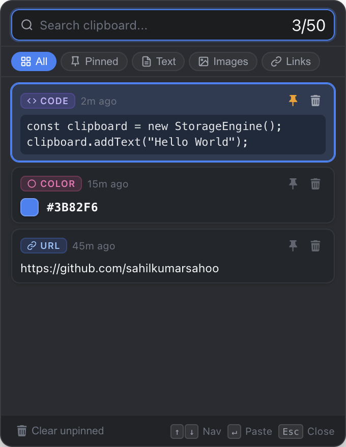
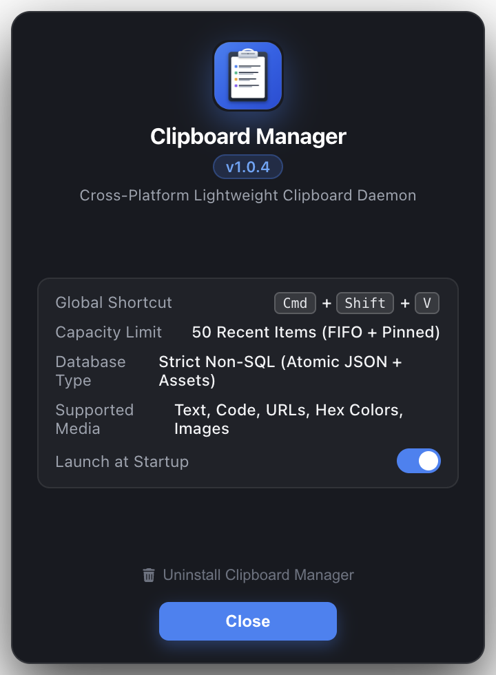
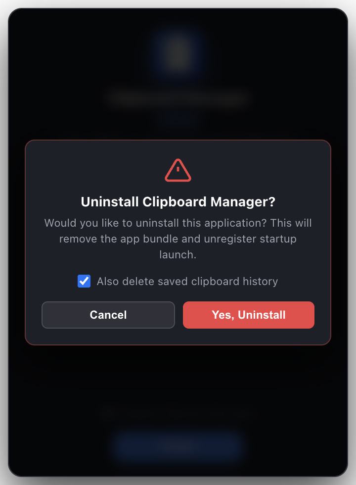
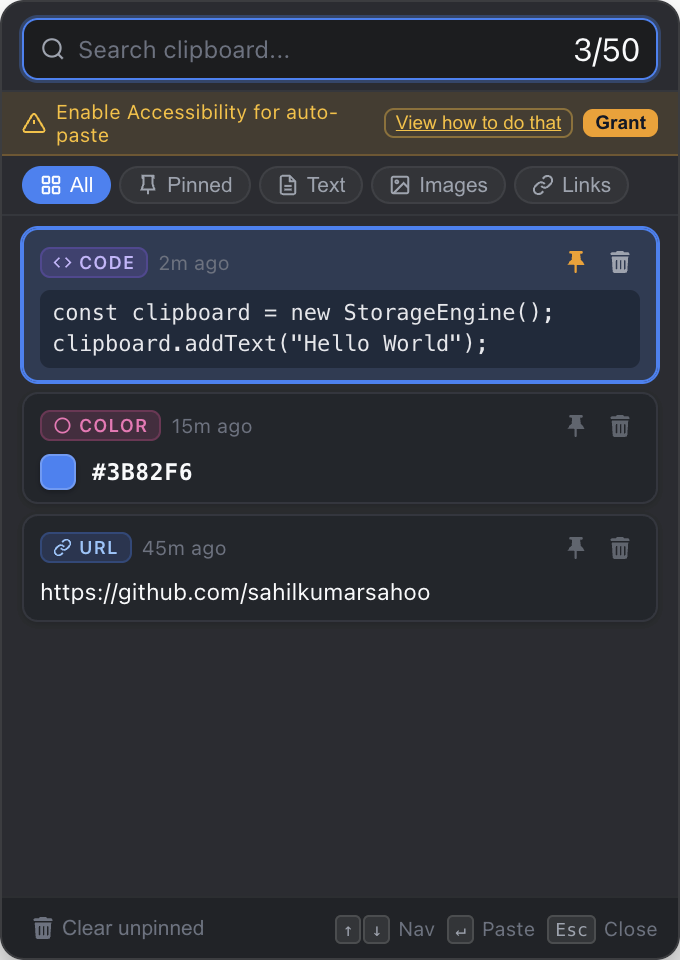

# 📋 Clipboard Manager (macOS & Ubuntu Linux)

<div align="center">
  <br/>
  <b>A lightning-fast, ultra-lightweight, cross-platform clipboard manager.</b><br/>
  <i>Features an instant floating acrylic HUD, auto-paste into active apps, zero Dock footprint, Font Awesome vector UI, atomic Non-SQL storage, and automated GitHub CI/CD releases.</i>
</div>

<br/>

<p align="center">
  
  &nbsp;&nbsp;&nbsp;&nbsp;
  
</p>

---

## 📸 Visual Showcase & How It Works

### 1. Instant Cursor-Anchored Floating HUD (`Cmd+Shift+V` / `Ctrl+Shift+V`)
Whenever you copy text, code, hex color codes, or images, Clipboard Manager captures them silently. Press your global hotkey and the floating acrylic HUD appears instantly anchored right beside your mouse pointer — on whichever monitor or desktop workspace you are working on:

<p align="center">
  
</p>

- **One-Click Auto-Paste**: Click any item card (or highlight with `↑` / `↓` and press `Enter`) — the HUD immediately dismisses and automatically injects a native `Cmd+V` / `Ctrl+V` keystroke directly into your active input field.
- **Smart Classification**: Auto-detects programming languages, web links, hex color swatches, plain text, and bitmap images.
- **Pinning**: Star your favorite snippets to keep them permanently saved in the 50-item FIFO ring buffer.
- **Zero Dock Footprint**: Operates as a pure macOS background accessory daemon (`LSUIElement: true`) — never clutters your bottom Dock toolbar.

### 2. Interactive Settings & Details
Click the Menu Bar icon or open the app from Applications to access system status, autostart toggle, and uninstallation:

<p align="center">
  
  &nbsp;&nbsp;&nbsp;&nbsp;
  
</p>

- **Autostart Control**: Native integration with macOS Login Items and Linux autostart.
- **Built-in Safe Uninstaller**: Cleanly removes the application bundle and startup entries with optional clipboard history wipe.

### 3. Integrated Permission Helper & Guide
If macOS Accessibility permissions are needed for keystroke simulation, a clean amber banner guides the user with a 1-click **Grant** button (opens System Settings directly) and a **View how to do that** link:

<p align="center">
  
</p>

## ⚡ Instant Install (Prebuilt Binaries)

Install the latest pre-compiled version directly in 3 seconds without downloading source or installing build tools:

```bash
curl -fsSL https://raw.githubusercontent.com/SahilKumarGit/Copy-To-Clipboard/main/install.sh | bash
```

To install a specific version:
```bash
curl -fsSL https://raw.githubusercontent.com/SahilKumarGit/Copy-To-Clipboard/main/install.sh | bash -s v1.0.0
```

---

## 🔄 Automated CI/CD Release Pipeline

When code is merged to `main` or `master`, the GitHub Actions pipeline ([`.github/workflows/release.yml`](.github/workflows/release.yml)) automatically:
1. Runs the test suite across platforms.
2. Compiles native Cocoa helpers and packages standalone `.dmg` and `.tar.xz` for macOS (Apple Silicon & Intel) and `.tar.xz` and `.deb` for Linux.
3. Automatically publishes a versioned GitHub Release with SHA-256 checksums.
4. Makes the release immediately available to the one-line installer.

---

## 📖 Step-by-Step Documentation

- **[User Guide (How to Use)](docs/HOW_TO_USE.md)**: Complete walkthrough of hotkeys, navigation, auto-pasting, pinning, categories, and tray controls.
- **[Installation Guide (How to Install)](docs/HOW_TO_INSTALL.md)**: Instant prebuilt installer, GitHub CI/CD details, macOS Accessibility permissions setup, autostart verification, and uninstall instructions.

---

## ✨ Features

- **Global Hotkey HUD**: Triggered instantly via `Cmd+Shift+V` (macOS) or `Ctrl+Shift+V` (Linux) right next to your active cursor.
- **Auto-Paste Injection**: Click any card or press `Enter` to automatically inject the content directly into your active input field.
- **Multi-Monitor Intelligent Clamping**: Seamlessly floats on whichever monitor or desktop workspace your mouse is located without snapping back to primary display.
- **Auto-Start on Reboot**: Automatically registers into **macOS Login Items** and `launchd` (`~/.config/autostart` on Linux) so you never need to manually start it.
- **Interactive About & Settings Pop-up**: Double-click the app in `/Applications` or click the Menu Bar icon to view version details, toggle autostart, and uninstall.
- **Built-in Safe Uninstaller**: Easily uninstall the app bundle with a confirmation dialog ("Would you like to uninstall this?") and optional history wipe.
- **Clean Vector UI**: 100% Font Awesome vector SVG icons for categories, pins, and deletion. Zero emojis.
- **50-Item FIFO Ring Buffer**: Maintains your 50 most recent copied items with pin-preservation.
- **Zero SQL / Pure Atomic Flat Storage**: Uses atomic JSON index files and an assets directory. Absolutely no SQLite or ORMs.

---

## 🏗️ Architecture & Specifications
Comprehensive documentation located in [`.agent-workflow/`](.agent-workflow/):
- [`ARCHITECTURE.md`](.agent-workflow/ARCHITECTURE.md)
- [`RESTRICTIONS_AND_GUIDELINES.md`](.agent-workflow/RESTRICTIONS_AND_GUIDELINES.md)
- [`UI_UX_SPECIFICATION.md`](.agent-workflow/UI_UX_SPECIFICATION.md)
- [`STORAGE_SPECIFICATION.md`](.agent-workflow/STORAGE_SPECIFICATION.md)
- [`SYNC_ROADMAP.md`](.agent-workflow/SYNC_ROADMAP.md)
- [`PHASES_AND_TASKS.md`](.agent-workflow/PHASES_AND_TASKS.md)
