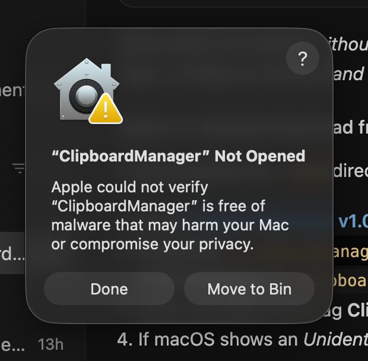

# 🚀 How to Install Clipboard Manager

This document provides complete, step-by-step instructions for installing, configuring permissions, managing versioned releases, setting up automatic launch on reboot, and uninstalling **Clipboard Manager** on macOS and Linux.

---

## ⚡ Quick Start: Instant Prebuilt Installer (Recommended)

You do **not** need to install Node.js, npm, or build tools. When code is merged to `main`/`master`, our GitHub CI/CD pipeline automatically compiles, tests, and publishes optimized standalone binaries to GitHub Releases.

Run this single command in your Terminal:

```bash
curl -fsSL https://raw.githubusercontent.com/SahilKumarGit/Copy-To-Clipboard/main/install.sh | bash
```

### What this command does in 3 seconds:
1. Detects your OS and processor architecture (`macOS Apple Silicon arm64`, `macOS Intel x86_64`, or `Ubuntu Linux`).
2. Fetches the latest pre-compiled release package from GitHub Releases.
3. Extracts and installs `ClipboardManager.app` directly into `/Applications/ClipboardManager.app`.
4. Removes macOS Gatekeeper quarantine (`xattr -cr`).
5. Registers the background daemon in macOS `launchd` and Login Items for automatic reboot loading.
6. Launches the application daemon immediately.

---

## 🏷️ Installing a Specific Version

You can install any previous release version by passing the version tag:

```bash
# Install a specific version via curl
curl -fsSL https://raw.githubusercontent.com/SahilKumarGit/Copy-To-Clipboard/main/install.sh | bash -s v1.0.0

# Or using an environment variable
VERSION=v1.0.0 curl -fsSL https://raw.githubusercontent.com/SahilKumarGit/Copy-To-Clipboard/main/install.sh | bash
```

---

## 🔄 GitHub CI/CD Automated Build Pipeline

Located at [`.github/workflows/release.yml`](../.github/workflows/release.yml):

- **Trigger**: Every push or pull-request merge into `main` or `master`.
- **macOS Build Job (`macos-latest`)**:
  - Sets up Node.js v20.
  - Compiles the native Cocoa paste injector with Clang (`native/paste-helper-mac.m` → `bin/paste-helper-mac`).
  - Packages standalone `.zip` and `.dmg` binaries for both **Apple Silicon (`arm64`)** and **Intel (`x64`)**.
- **Linux Build Job (`ubuntu-latest`)**:
  - Packages `.AppImage`, `.tar.gz`, and `.deb` for standard Linux distributions.
- **Release Publisher Job**:
  - Reads version from `package.json` (`v1.0.0`).
  - Computes cryptographic SHA-256 checksums (`SHA256SUMS.txt`).
  - Publishes or updates the GitHub Release tag on `SahilKumarGit/Copy-To-Clipboard` with all binary assets attached.

---

## 🛠️ Building from Source Locally (Optional)

If you prefer building from source rather than downloading pre-compiled releases:

```bash
# 1. Clone repository
git clone https://github.com/SahilKumarGit/Copy-To-Clipboard.git
cd Copy-To-Clipboard

# 2. Run installer with --build flag
bash install.sh --build
```

Or manually:
```bash
npm install
clang -Wall -Wextra -Werror -framework ApplicationServices -framework Cocoa native/paste-helper-mac.m -o bin/paste-helper-mac
npx electron-builder --mac dmg zip
cp -R dist/mac-arm64/ClipboardManager.app /Applications/
open /Applications/ClipboardManager.app
```

---

## 🛡️ macOS Gatekeeper: "ClipboardManager is damaged and can't be opened"

If you download the `.dmg` or `.zip` directly through a web browser (Google Chrome, Safari), macOS automatically tags the file with a quarantine attribute (`com.apple.quarantine`). On macOS Sonoma and Sequoia, unsigned open-source applications will display:

> *“ClipboardManager” is damaged and can’t be opened. You should move it to the Bin.*



**The application is NOT damaged.** This is standard macOS Gatekeeper behavior for downloaded unsigned binaries.

### Quick Fix (Run in Terminal):
```bash
xattr -cr /Applications/ClipboardManager.app
```
Then launch the app normally:
```bash
open /Applications/ClipboardManager.app
```

> [!TIP]
> **Avoid this prompt completely:** If you install using the [One-Line Installer](#-instant-one-line-installation-recommended), the installer automatically removes the quarantine attribute during extraction so this message never appears!

---

## 🔐 Granting macOS Accessibility Permissions

> [!IMPORTANT]
> macOS Sonoma, Sequoia, and Ventura require Accessibility authorization for applications that inject synthetic keystrokes (auto-pasting into other applications).

When Clipboard Manager runs for the first time, macOS will automatically prompt you to grant Accessibility access:

1. Open **System Settings**.
2. Navigate to **Privacy & Security** → **Accessibility**.
3. Locate **ClipboardManager** in the list.
4. Toggle the switch to **ON** (blue).
5. If prompted, authenticate with your Mac password or Touch ID.

```
System Settings
 └── Privacy & Security
      └── Accessibility
           └── [✓] ClipboardManager  <-- ENABLE THIS
```

---

## 🔄 Automatic Startup on System Restart

Clipboard Manager is designed to function as an invisible, zero-maintenance background daemon:

- **Built-in Startup**: During initial launch, the app automatically registers with native **macOS Login Items** (`app.setLoginItemSettings`).
- **Verification**:
  - Open **System Settings** → **General** → **Login Items**.
  - Confirm **ClipboardManager** is listed under **"Open at Login"**.

---

## 🗑️ How to Uninstall

### Method 1: Built-in GUI Uninstaller (Recommended)
1. Open the **About** window:
   - Click **ClipboardManager** in your `/Applications` list, **OR**
   - Click the Menu Bar icon and select **"About Clipboard Manager..."**.
2. Click **"Uninstall Clipboard Manager"** at the bottom.
3. In the confirmation modal, optionally check *"Also delete saved clipboard history"*.
4. Click **"Yes, Uninstall"**. The app disables autostart, safely deletes `/Applications/ClipboardManager.app`, and exits.


### Method 2: Manual Removal via Terminal
```bash
# 1. Stop running process
killall ClipboardManager 2>/dev/null || true

# 2. Clean any legacy launch agent plist
launchctl bootout gui/$(id -u)/com.clipboardmanager.app 2>/dev/null || true
rm -f ~/Library/LaunchAgents/com.clipboardmanager.app.plist 2>/dev/null || true

# 3. Remove application bundle
rm -rf /Applications/ClipboardManager.app

# 4. (Optional) Wipe clipboard history database and assets
rm -rf "$HOME/Library/Application Support/copy-to-clipboard"
```
